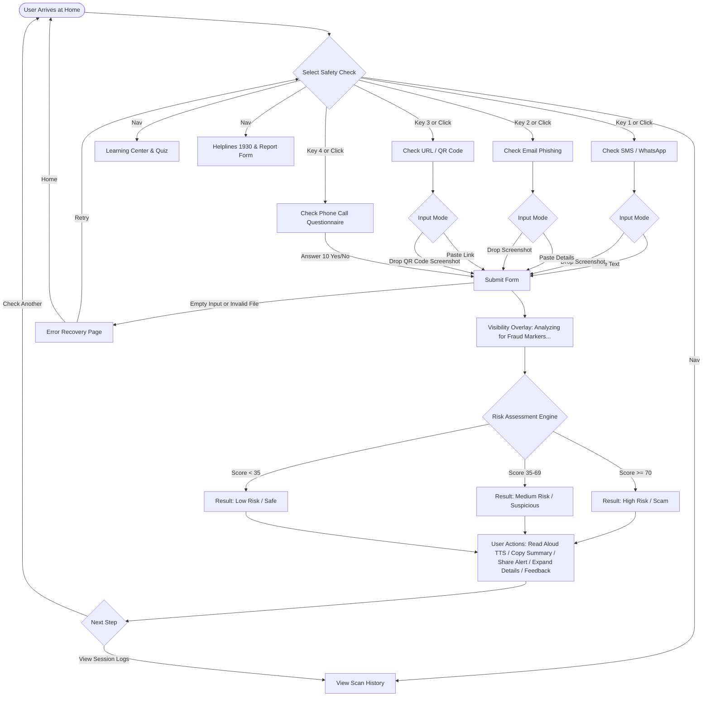

# ScamShield: Low-Fidelity Wireframe System & HCI Architecture Plan

## 1. Executive Summary & Purpose
This document provides a comprehensive structural audit of the ScamShield codebase (`app.py`, `templates/`, `static/`, and `translations.py`) and outlines the specifications for low-fidelity wireframes representing every user-facing screen and state of the application.

All wireframes strictly reflect features and components currently implemented in the codebase—no extraneous or fictitious elements are introduced. The design follows low-fidelity specifications (greyscale palette, labelled bounding boxes for icons, text-based risk borders, WCAG 2.2 touch targets $\ge 44\text{px}$, body text $\ge 16\text{px}$, and numbered HCI callouts mapped directly to the **ScamShield HCI Implementation Checklist**).

---

## 2. Complete Route & Template Audit

| HTTP Route | Method(s) | Python Handler (`app.py`) | Rendered Template | Primary Purpose & UI Description |
| :--- | :--- | :--- | :--- | :--- |
| `/` | `GET` | `index()` | `index.html` | **Home Dashboard**: Hero section, dismissible onboarding guide, and 4 primary check cards with keyboard shortcuts (1-4). |
| `/check/sms` | `GET` | `check_sms()` | `sms.html` | **SMS / WhatsApp Checker**: Dual-mode input (text textarea with paste/clear vs screenshot file upload dropzone), demo sample buttons. |
| `/analyze/sms` | `POST` | `analyze_sms()` | `result.html` / `error.html` | **SMS Analysis Controller**: Processes SMS text or OCR image; outputs risk assessment or error recovery view. |
| `/check/email` | `GET` | `check_email()` | `email.html` | **Email Phishing Checker**: Sender, subject, and body inputs; screenshot dropzone; demo phishing samples. |
| `/analyze/email` | `POST` | `analyze_email()` | `result.html` / `error.html` | **Email Analysis Controller**: Evaluates sender, subject, body, and extracted links; outputs risk assessment or error recovery view. |
| `/check/url` | `GET` | `check_url()` | `url.html` | **URL & QR Code Checker**: Dual-mode input (URL text field vs QR code / screenshot image dropzone with camera capture support), sample URL/QR chips. |
| `/analyze/url` | `POST` | `analyze_url()` | `result.html` / `error.html` | **URL Analysis Controller**: Decodes QR code payloads or extracts OCR URLs; evaluates domain heuristics and ML model; outputs risk assessment. |
| `/check/phone` | `GET` | `check_phone()` | `phone.html` | **Phone Call Questionnaire**: 10-question evaluation chunked into 2 parts of 5 questions each, dynamic progress bar, Yes/No radio buttons. |
| `/analyze/phone` | `POST` | `analyze_phone()` | `result.html` | **Phone Analysis Controller**: Computes heuristic risk score based on high-threat answers; outputs risk assessment. |
| `/history` | `GET` | `view_history()` | `history.html` | **Scan History**: Displays local session checks, search bar, risk level filter dropdown, CSV export button, print button, clear modal trigger, or empty state. |
| `/history/clear` | `POST` | `clear_history()` | Redirects to `/history` | **Clear History Endpoint**: Empties session history array and flashes confirmation. |
| `/history/export` | `GET` | `export_history()` | Direct CSV download | **CSV Export Endpoint**: Generates downloadable CSV of session scan records. |
| `/learn` | `GET` | `learn()` | `learn.html` | **Scam Awareness & Learning Center**: Common scam pattern cards, 3 interactive quiz scenarios with immediate feedback, expandable FAQ accordion. |
| `/report` | `GET`, `POST` | `report_scam()` | `report.html` | **Incident Reporting & Helplines**: Official helplines (1930 & cybercrime.gov.in), emergency checklist, and community threat report form / submitted confirmation. |
| `/set_language/<lang>` | `GET` | `set_language()` | Redirects to referrer | **Localization Switcher**: Toggles active language between English (`en`), Marathi (`mr`), and Hindi (`hi`). |
| `/api/feedback` | `POST` | `submit_feedback()` | JSON response | **HCI Feedback API**: Logs user response to "Was this assessment helpful?" widget. |
| Error 404 / 413 / 500 | Internal | `page_not_found()`, etc. | `error.html` | **Error & Recovery Page**: Displays user-friendly error title, plain-language description, retry button, home button, and 4 quick recovery chips. |

---

## 3. Shared Components Inventory

Every screen inherits from `templates/base.html` and includes the following consistent global components:

1. **Accessibility Skip Link**:
   - `href="#main-content"`: Bypasses header for keyboard and screen-reader users (WCAG 2.4.1).
2. **Global Application Header**:
   - **Branding**: Logo icon box `[icon: Shield]`, title `SCAMSHIELD`, subtitle `AI Scam Detection & Risk Assessment`.
   - **Accessibility & Utility Toolbar**:
     - **Font Size Resizer**: 3 distinct buttons (`[A-]` Smaller, `[A]` Default, `[A+]` Larger) controlling visual body zoom, CSS custom property `--font-scale`, and root rem units.
     - **Theme Switcher**: Button toggling light mode and dark mode (`[icon: Moon/Sun]`), persisted in `localStorage`.
     - **Accessibility Menu**: Dropdown button `[icon: Accessibility]` toggling Dyslexia-friendly font (`OpenDyslexic`) and High Contrast mode (4.5:1+ contrast ratio).
     - **Language Switcher**: Clickable pills for English (`EN`), Marathi (`मराठी`), and Hindi (`हिन्दी`).
   - **Primary Navigation Bar**:
     - Direct links: `Home`, `SMS`, `Email`, `URL / QR`, `Phone`, `History`, `Learn`, `Report Scam`.
3. **Global Analyzing Loading Overlay**:
   - Hidden by default; activates on form submission (`action*="/analyze/"`).
   - Elements: Centered modal card, loading spinner `[icon: Spinner]`, title `Analyzing Content for Fraud Markers...`, subtitle `Inspecting text patterns, urgency signals, and security risks...` (Nielsen Heuristic #1: Visibility of System Status).
4. **Accessible Confirmation Modal Backdrop**:
   - `#accessible-modal-backdrop`: Traps focus for destructive actions (e.g., clearing history).
   - Dialog box with `Confirm Action` heading, `Are you sure you want to proceed?` description, `Cancel` button, and `Confirm` button (Shneiderman Rule #5 & #6).
5. **Toast Notification System**:
   - `#toast-container`: Floating toast pill in bottom-right corner for transient system status feedback (e.g., "Result summary copied to clipboard!").
6. **Global Application Footer**:
   - **Privacy Notice**: Shield icon `[icon: Lock]` + plain-language privacy assurance (no storage of sensitive credentials, automatic masking).
   - **Trust & Project Credential**: `© 2026 ScamShield • Machine Learning Lab Project • Built for Simplicity and Accessibility`.

---

## 4. UI States Inventory

The wireframes capture all key interface states identified in the audit:

| Screen / Flow | State | Visual Representation & Indicators |
| :--- | :--- | :--- |
| **Home Dashboard** | Default (New User) | Shows full Onboarding Quick-Start Guide banner with 3 steps. |
| **Home Dashboard** | Dismissed Onboarding | Clean hero layout without onboarding banner; 4 check cards with keyboard badges `[1]`, `[2]`, `[3]`, `[4]`. |
| **Check Forms (SMS/Email/URL)** | Empty Input (Initial) | Active Paste Text tab, empty textarea/inputs, paste & clear tools, demo sample buttons. |
| **Check Forms (SMS/Email/URL)** | Screenshot Dropzone | Active Upload Screenshot tab, dashed bounding box `[icon: Upload]`, drag-and-drop text, browse button. |
| **Check Forms (SMS/Email/URL)** | File Attached / Ready | File preview pill showing filename, size in KB, and `[Remove]` button. |
| **Phone Questionnaire** | 0% Unanswered | Progress bar at 0%, 0/10 count, two 5-question chunks with unselected `[No]` / `[Yes]` radio buttons. |
| **Phone Questionnaire** | In-Progress / Completed | Progress bar at 100%, 10/10 count, radio buttons filled with active state indicators. |
| **Assessment Result** | **High Risk (Scam)** | Score 70-100, **double border**, `🚨 Potential Scam (High Risk)` badge, red top action callout ("Do NOT click, block sender"), highlighted keywords `<mark>`, reasons list, actions checklist. |
| **Assessment Result** | **Medium Risk (Suspicious)** | Score 35-69, **dashed border**, `⚠️ Suspicious (Medium Risk)` badge, warning callout ("Proceed with caution, verify sender"), reasons & actions. |
| **Assessment Result** | **Low Risk (Safe)** | Score 0-34, **solid border**, `🛡️ Potentially Safe` badge, safe callout ("Content appears safe, exercise normal caution"), explanation note. |
| **Assessment Result** | Accordion Collapsed / Expanded | Progressive disclosure accordion toggle (`▼` / `▶`) controlling technical details, feedback widget, and disclaimer. |
| **Scan History** | Populated History | List of scan cards with type badge, timestamp, masked snippet, risk score, risk badge; search input; risk level filter dropdown. |
| **Scan History** | Empty History | Empty mailbox icon `[icon: Empty Box]`, "No Scans Performed Yet", "Go to Home" button. |
| **Community Report** | Initial Form | Dropdown for scam channel, input for offender info, textarea for details, submit button, emergency helpline cards (1930). |
| **Community Report** | Submitted State | Green checkmark card `[icon: Check]`, "Your incident report has been submitted", thank you notice. |
| **Error Screen** | Error Recovery | Warning box `[icon: Alert]`, error title (e.g. Empty Message or 404), explanation, "Try Again", "Back to Home", 4 quick recovery chips. |
| **Global Overlays** | Loading / Modal / Toast | Fullscreen semi-transparent backdrop with active analyzing spinner, confirmation modal dialog, and toast pill. |

---

## 5. User Flow Architecture

---

## 6. Files to be Created in `/wireframes`

All wireframe HTML pages share a single unified stylesheet (`wireframes/styles.css`), rendering responsive side-by-side viewports (Mobile: 390px, Desktop: 1280px) with numbered HCI annotations.

1. `wireframes/PLAN.md` - System audit, architectural inventory, user flows, and specifications (this document).
2. `wireframes/styles.css` - Unified greyscale, low-fidelity design system (1-2px borders, 44px touch targets, 16px body font, labeled icon boxes, text-and-border risk styles).
3. `wireframes/index.html` - Master wireframe gallery linking to all screens, states, flows, and specs.
4. `wireframes/flow.html` - Visual interactive user-flow diagram covering primary journeys, branches, and error recovery.
5. `wireframes/home.html` - Screen 1: Home Dashboard (Default with Onboarding & Dismissed state).
6. `wireframes/sms.html` - Screen 2: Check SMS / WhatsApp (Paste Text tab & Screenshot Upload tab).
7. `wireframes/email.html` - Screen 3: Check Email Phishing (Paste Details tab & Screenshot Upload tab).
8. `wireframes/url.html` - Screen 4: Check URL / QR Code (Paste Link tab & QR Code Screenshot Upload tab).
9. `wireframes/phone.html` - Screen 5: Phone Call Questionnaire (Miller's Law 5-item chunks & Progress bar).
10. `wireframes/result_high.html` - Screen 6: Analysis Result - High Risk (Score 85, double border, red callout, keyword highlights, why/what accordion).
11. `wireframes/result_medium.html` - Screen 7: Analysis Result - Medium Risk (Score 52, dashed border, warning callout).
12. `wireframes/result_low.html` - Screen 8: Analysis Result - Low Risk (Score 12, solid border, safe callout).
13. `wireframes/history.html` - Screen 9: Scan History (Populated list with search/filter & Empty State).
14. `wireframes/learn.html` - Screen 10: Scam Awareness & Learning Center (Patterns, Interactive Quiz, FAQ accordion).
15. `wireframes/report.html` - Screen 11: Community Scam Report & Emergency Helplines (1930 & cybercrime.gov.in).
16. `wireframes/error.html` - Screen 12: Error Handling & Recovery Page (Empty input, 404, error jump chips).
17. `wireframes/overlays.html` - Screen 13: UI Modals, Overlays & Microinteractions (Analyzing loading overlay, Confirmation modal, Toast notification, A11y dropdown).
18. `wireframes/images/` - Standalone high-resolution downloadable PNG screenshots of each wireframe screen.
